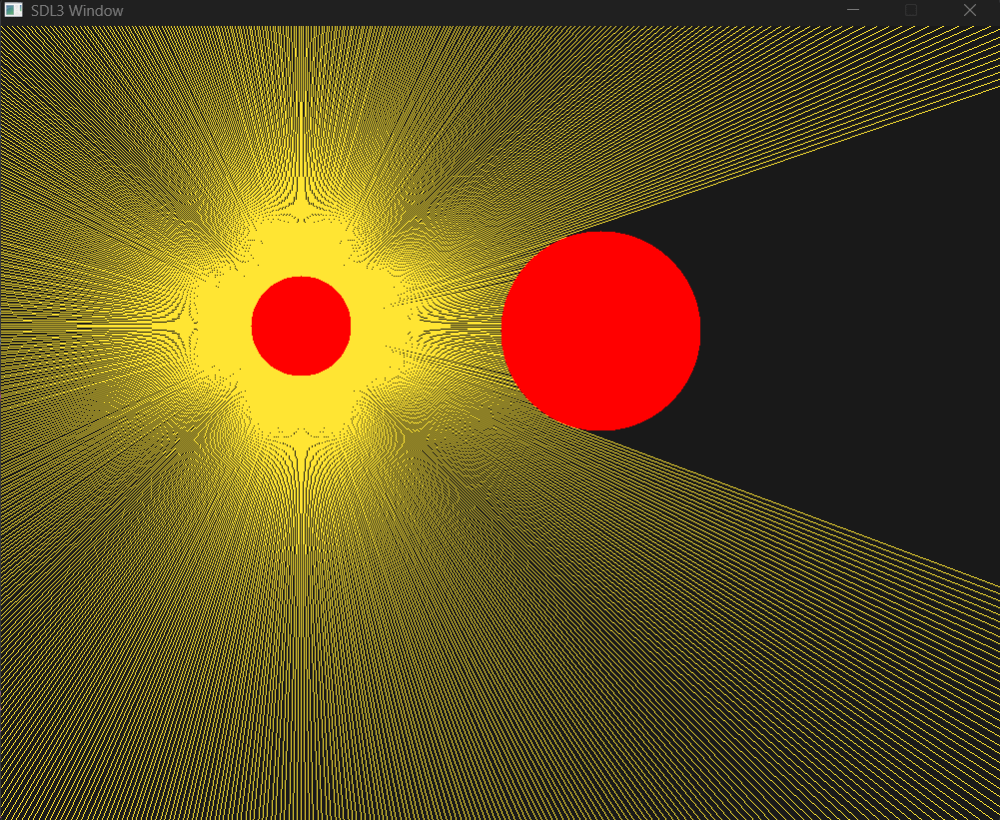

# 2D Ray Tracing Practice (C + SDL3)

👋 一个基于 **C 语言** 与 **SDL3** 的简易 2D 光线传播与动态阴影模拟练习项目。

## 💡 功能特点 (Features)

* **360° 全向光线发射**：从光源中心均匀向四周投射 720 条采样光线。
* **数学几何求交**：基于一元二次方程判别式($\Delta = B^2 - 4AC$)进行精确的射线-圆碰撞检测。
* **动态阴影生成**：支持移动障碍物与拖拽光源，实时更新光线遮挡与硬阴影效果。
* **包围盒渲染优化**：采用 Bounding Box 算法优化球体像素绘制，大幅降低 CPU 计算负担。

---

## 📐 数学原理 (Mathematics)

1. **射线方程 (Ray Equation)**：
   - $x = o_x + t \cdot d_x$
   - $y = o_y + t \cdot d_y$

其中 $(o_x, o_y)$ 为光源圆心， $(d_x, d_y)$ 为归一化方向向量(满足 $d_x^2 + d_y^2 = 1$)。

2. **圆方程与代入求交 (Intersection)**：
   代入障碍物圆方程 $(x - c_x)^2 + (y - c_y)^2 = R^2$，整理得到关于传播距离 $t$ 的一元二次方程 $At^2 + Bt + C = 0$：
   * $A = 1$
   * $B = 2 \cdot (d_x \cdot dx_0 + d_y \cdot dy_0)$
   * $C = dx_0^2 + dy_0^2 - R^2$
   
   通过判别式 $\Delta = B^2 - 4AC$ 即可快速判断光线是否命中障碍物，并求出最近的有效交点距离 $t = \frac{-B - \sqrt{\Delta}}{2}$。

---

## 🛠️ 编译与运行 (Build & Run)

### 1. 环境准备
* 支持 C99/C++ 的编译器（如 GCC, Clang, MinGW 等）
* [SDL3 开发库](https://github.com/libsdl-org/SDL)

### 2. 编译命令 (Windows GCC / MinGW)
如果你的工程目录包含 `include` 与 `lib` 依赖，可以使用如下指令：
```powershell
g++ raying.c -o raying.exe -I./include -L./lib -lSDL3
```
### 3. 运行程序
```powershell
./raying.exe
```
## 🎮 操作说明 (Controls)
+ 鼠标左键拖拽：按住并拖动光源圆 $C1$，可以实时观察光线碰撞与动态阴影的变化。
+ 自动平移：障碍物 $C2$ 会在窗口上下边界之间自动碰撞反弹。
## 🙏 鸣谢与交流 (Acknowledgments)
+ 感谢 B 站视频[C语言从零实现光线追踪，效果惊艳 | Daniel Hirsch](https://www.bilibili.com/video/BV1Qq7m6PEuA)
+ 感谢 SDL3 团队提供如此清爽高效的跨平台 GUI / 渲染库。
> 💡 **写在最后**：初学C语言的迷你练习，代码或许尚有不优雅之处，感谢指正！
